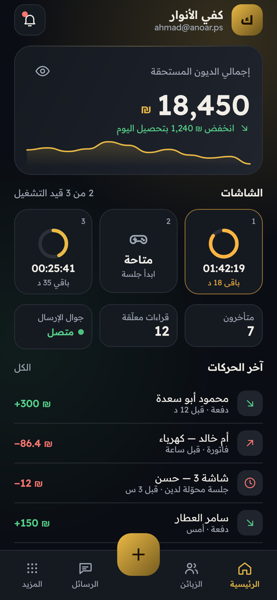
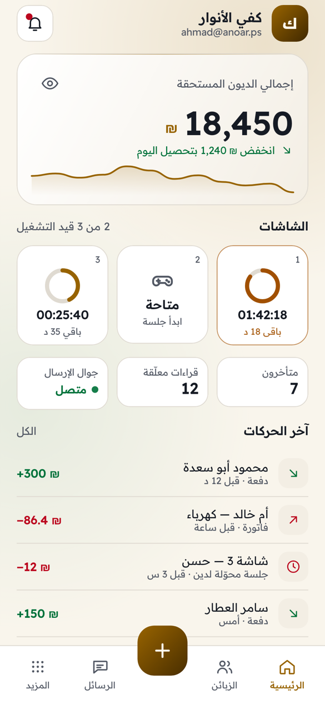

# قيد

**كل حق في قيده.** 
دفتر ديون وإدارة محلات لأندرويد: محلات وموظفون بصلاحيات، مزامنة فورية بين الأجهزة، شاشات PlayStation بعدّاد، مشتركو كهرباء، ورسائل SMS من جوال المحل نفسه.

 

&nbsp;

## الحالة

النسخة 0.1.0: الهيكل الأساسي والشاشة الرئيسية بالتصميم المعتمد. المتطلبات الكاملة والقرارات في [docs/SPEC.md](docs/SPEC.md).

## التقنية

- Kotlin + Jetpack Compose، أندرويد 8.0 فأحدث.
- Firebase (Auth + Firestore) بمشروع واحد لكل المحلات، ويعمل التطبيق بدون إنترنت ثم يزامن.
- يُبنى الـ APK تلقائياً على GitHub Actions مع كل رفع، ويُنشر في صفحة الإصدارات.

## التنزيل

من [صفحة الإصدارات](https://github.com/Dev-saged/Qayd/releases/latest).

## المطوّر

ساجد العبادلة — [GitHub](https://github.com/Dev-saged) · [واتساب](https://wa.me/972597857250) · [إنستغرام](https://instagram.com/sajedd.0)

